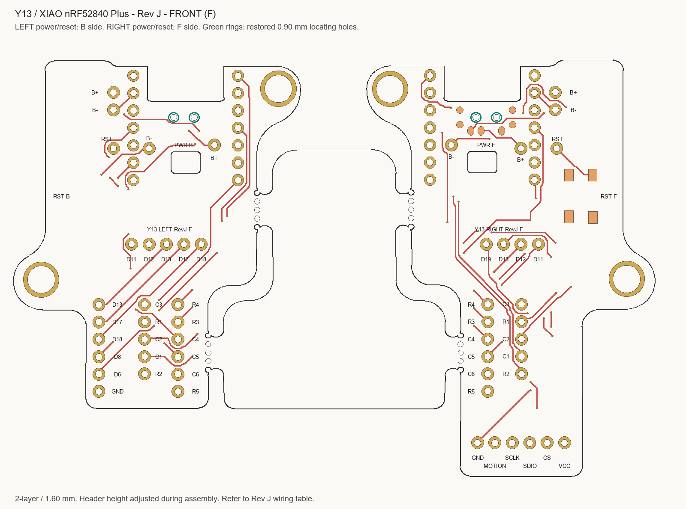
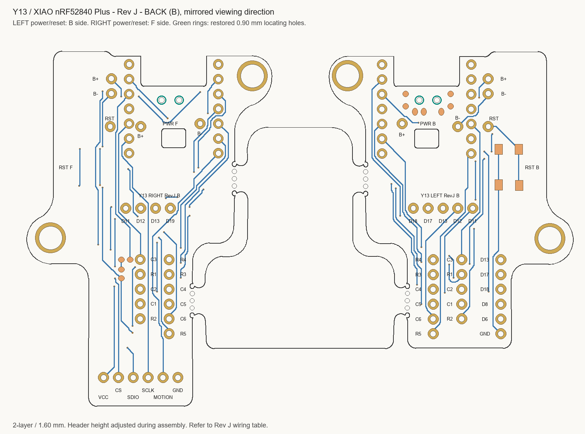

# Rev J 修正版試作基板

**[発注用Gerber ZIP](Y13-XIAO-revJ-order-gerbers.zip?raw=true)**

FR-4・2層・板厚 **1.6 mm**。電源穴と印字を修正し、左スイッチ実装面の照合状況を記録した版。

- 左のRESET SW1と電源SW3はB面を指定。旧基板名の印字側（F面）にマイコンを載せるという回答に対応する。旧ZIPでもB面だったため、実物での面違いの原因は照合待ち。
- 電源スイッチの位置決め穴を左右2個ずつ、φ0.90 mmで復元。
- B+・B−、行列C1〜C6/R1〜R5、RST、PWR、GPIO、センサー端子名を両面に追加。

**左のRESET・電源はB面、右のRESET・電源はF面に実装する。** 基板名にF/Bを明記し、PWR B・RST B／PWR F・RST Fを印字した。再発注前に、実物の左面違いについて発注ZIPと両面写真で照合する必要がある。

## F面

## B面から見た向き

## 検証と配線

- [修正内容・再検証の詳細](verification-report.md)
- [DRC結果](drc.txt)は違反0・未配線0。
- [Gerber検証](verification.json)。PTH150点、NPTH16点を基板データと照合。
- [ピン接続表](pin-connections.csv)
- [右トラックボール配線](trackball.csv)。F面からUSBを上に見て左からGND / MOTION / SCLK / SDIO / CS / VCC。

XIAOの部品面はキャリアへ向ける。高さと支持部材は実物で調整する。ケース適合・修正版への実装・電池の充電条件は実機で確認する。

Rev I以前のGerberは旧版。既存ファームウェアのGPIO割当は維持しているが、修正版での実機動作は未検証。
