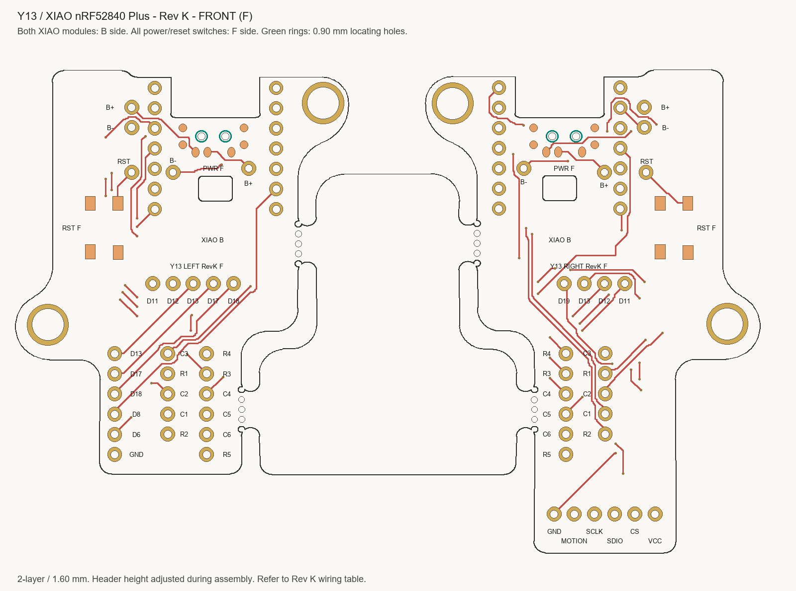
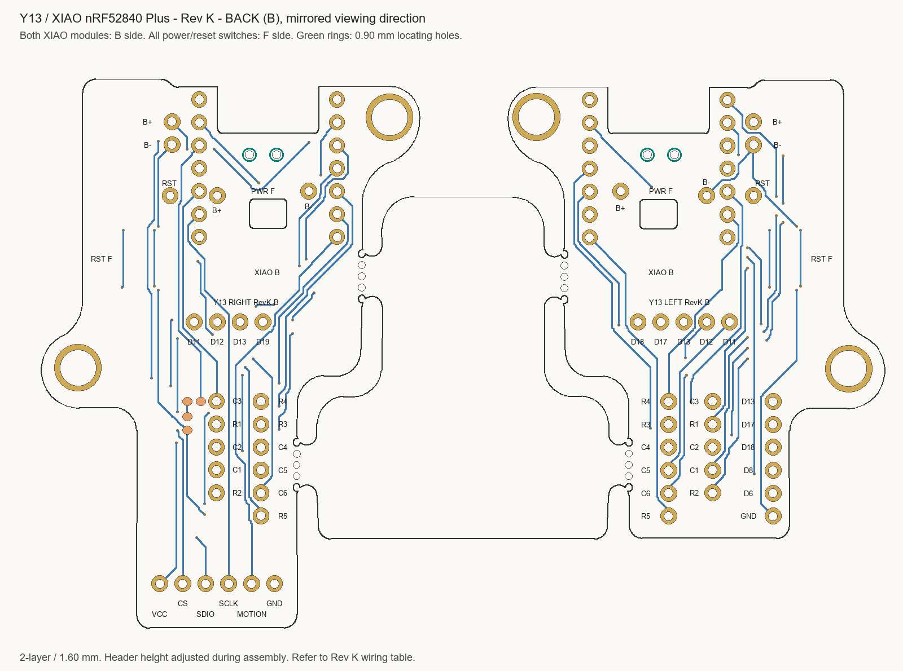

# Rev K 基板

**[発注用Gerber ZIP](Y13-XIAO-revK-order-gerbers.zip?raw=true)**

FR-4・2層・板厚 **1.6 mm**。

|部品|左|右|
|---|---|---|
|XIAO nRF52840 Plus|B面|B面|
|RESETボタン|F面|F面|
|スライド電源|F面|F面|

XIAOの部品面はキャリアへ向ける。基板にはXIAO B、PWR F、RST F、F/Bを印字した。左の14端子をB面取付けに合わせて反転し、再配線している。

## F面

## B面から見た向き

## 配線・検証

- [取付と検証記録](verification-report.md)
- [ピン接続表](pin-connections.csv)
- [センサー配線表](trackball.csv)
- [DRC](drc.txt)は違反0・未配線0。
- [Gerber検証記録](verification.json)はPTH154点・NPTH16点を照合済み。電源の位置決め穴は左右2個ずつφ0.90 mm。

右下端子はF面からUSBを上に見てGND / MOTION / SCLK / SDIO / CS / VCC。

GPIO信号の割当は既存XIAO用ファームウェアと同じ。左右各5行6列で左29キー、右27キー＋トラックボールに対応する。

高さと支持部材は実物で調整する。修正版での実装・ケース適合・充電・無線動作は未検証。Rev J以前の取付構成・接続座標は旧版。
